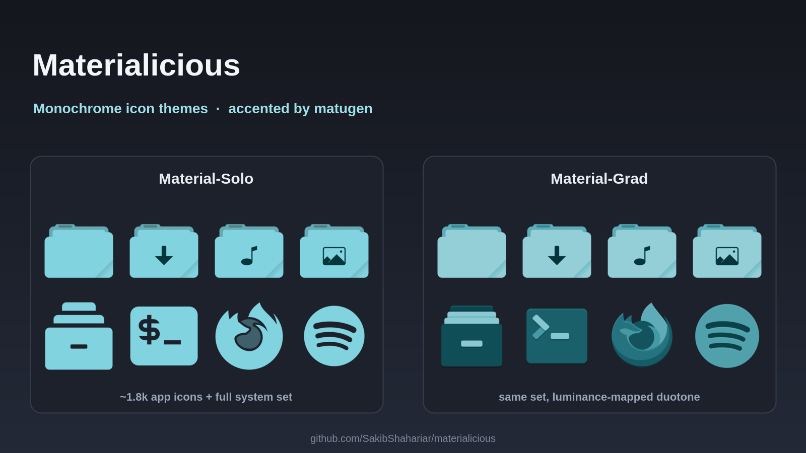

# Materialicious

A monochrome icon theme family for Linux desktops, with two Matugen-aware color styles.

<p align="center">
  
</p>

<p align="center">
  <a href="Material-Solo/LICENSE"></a>
  
  
</p>

## Styles

- **Material-Solo** — flat icons with a single baked-in accent color. It does not automatically change when Matugen updates.
- **Material-Grad** — duotone icons mapped from dark to accent colors. The included Matugen hook recolors this variant when the palette changes.

Both themes combine a monochrome icon set with Tela-inspired folder shapes and additional application glyphs. Application artwork is derived from upstream icons; see [Sources and licensing](#sources-and-licensing).

## Install

Clone or download this repository, then run:

```sh
./install.sh
gsettings set org.gnome.desktop.interface icon-theme Material-Grad
```

Choose `Material-Solo` instead if you prefer the static flat style. The installer links the themes into `~/.icons`.

For Matugen integration and dependency setup, follow [SETUP.md](SETUP.md). Only Material-Grad is recolored by the provided hook.

## Recolor and add icons

The generator `mono-icons.py` recolors SVG artwork. For example, to recolor an existing Grad icon:

```sh
python3 mono-icons.py --dark "#000000" --light "#c9bfff" --radius 0.5 \
  --linear Material-Grad/apps/scalable/<icon>.svg
```

To create a duotone icon from source artwork, place the source SVG in `sources/` and run:

```sh
python3 mono-icons.py --dark "#000000" --light "#c9bfff" --radius 0.5 \
  --autoscale --outdir Material-Grad/apps/scalable sources/<app>.svg
```

The generator writes a `.mono.svg` output. Review it before replacing an existing theme icon. The `sources/` directory is used when adding icons, not during normal Matugen recoloring.

## Request an icon

Before opening a request, check whether the icon already exists. Use the [missing-icon issue template](.github/ISSUE_TEMPLATE/missing-icon.yml) and include the application ID or icon name, icon context, and an official upstream source when available.

## Sources and licensing

Materialicious incorporates or derives artwork from several projects:

- [Yet Another Monochrome Icon Set (YAMIS)](https://bitbucket.org/dirn-typo/yet-another-monochrome-icon-set) by dirn, loosely based on Orion by Storm Rosenaa.
- [Tela](https://github.com/vinceliuice/Tela-icon-theme) by vinceliuice, used for folder shapes and source glyphs.
- [Papirus](https://github.com/PapirusDevelopmentTeam/papirus-icon-theme), used for selected application and fallback glyphs.
- [GNOME Adwaita / hicolor](https://gitlab.gnome.org/GNOME/adwaita-icon-theme), used for a small number of system glyphs.
- [Bibata](https://github.com/ful1e5/Bibata_Cursor), whose Matugen-accent workflow is followed by the sibling cursor themes.
- Individual application icons from Flathub and their respective upstream projects.
- [Matugen](https://github.com/InioX/matugen), used to generate palette colors.

The `Authors` files in both theme directories retain the required YAMIS attribution. Materialicious is distributed under **GPL-3.0-only**; see [Material-Solo/LICENSE](Material-Solo/LICENSE) and [Material-Grad/LICENSE](Material-Grad/LICENSE). This project license does not replace the separate licenses or ownership of third-party application artwork.
